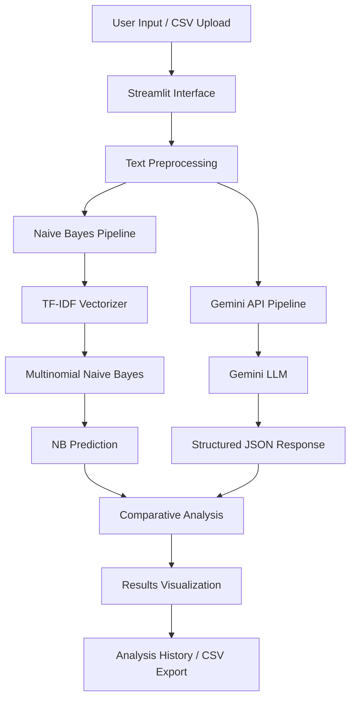

# Sentiment Analysis Comparative Studio

**A Comparative Study of Traditional Machine Learning and Large Language Models for Sentiment Analysis**

A Python-based sentiment analysis application that compares two approaches to classifying text into Positive, Negative, and Neutral sentiment categories:

- **Traditional Machine Learning:** Multinomial Naïve Bayes with TF-IDF feature extraction.
- **Large Language Model:** Google Gemini API for contextual sentiment classification.

The application provides an interactive interface to analyse user-provided text, inspect prediction scores, and compare the outputs of both approaches.

---

## 1. Project Overview

Sentiment analysis is a Natural Language Processing (NLP) task that identifies the emotional polarity expressed in textual data.

Traditional machine learning algorithms learn patterns from labelled training data, whereas Large Language Models can interpret textual context, tone, negation, and other linguistic cues.

This project implements both approaches and compares their predictions using a common input.

## 2. Objectives

- Implement sentiment classification using the Multinomial Naïve Bayes algorithm.
- Apply text preprocessing and TF-IDF feature extraction.
- Integrate Google's Gemini API for LLM-based sentiment analysis.
- Compare the predictions of traditional machine learning and LLM-based approaches.
- Visualise sentiment scores and prediction differences through an interactive interface.
- Support individual text analysis and CSV-based batch analysis.

## 3. Technologies Used

| Component | Technology |
|---|---|
| Programming language | Python |
| Frontend / Interface | Streamlit |
| Machine Learning | Scikit-learn |
| Classification algorithm | Multinomial Naïve Bayes |
| Feature extraction | TF-IDF Vectorizer |
| Dataset | CardiffNLP TweetEval |
| LLM integration | Google Gemini API |
| Gemini SDK | google-genai |
| Data handling | Pandas, NumPy |
| Model persistence | Joblib |
| Environment configuration | python-dotenv |

## 4. Dataset

**CardiffNLP TweetEval – Sentiment**

Source: [Hugging Face – TweetEval](https://huggingface.co/datasets/cardiffnlp/tweet_eval)

The project uses the sentiment configuration of the TweetEval dataset.

It contains three sentiment classes:

- Negative
- Neutral
- Positive

The dataset provides separate training, validation, and test splits.

The training split is used to train the Naïve Bayes classifier, while validation and test splits are used to assess its performance.

## 5. Methodology

### 5.1 Text Preprocessing

Input text is processed using the preprocessing module before feature extraction.

The same preprocessing pipeline is applied during model training and prediction to maintain consistency.

### 5.2 TF-IDF Feature Extraction

Term Frequency–Inverse Document Frequency (TF-IDF) converts textual data into numerical feature vectors.

The implementation uses:

- Lowercase text conversion
- Unicode accent stripping
- Unigrams and bigrams (`ngram_range=(1, 2)`)
- Minimum document frequency of 2
- Sublinear term frequency scaling

### 5.3 Naïve Bayes Classification

The project uses the Multinomial Naïve Bayes algorithm.

Configuration:

- Algorithm: `MultinomialNB`
- Smoothing parameter: `alpha=1.0`
- Prior fitting: `fit_prior=True`

The classifier learns from the TF-IDF vectors and predicts one of the three sentiment classes.

The application displays the predicted class, class-wise scores, prediction confidence, and inference time.

### 5.4 Gemini-Based Sentiment Analysis

The second approach uses Google's Gemini API through the official `google-genai` Python SDK.

A structured prompt instructs the LLM to return JSON containing:

- Predicted sentiment
- Estimated Positive, Negative, and Neutral scores
- Explanation of the prediction
- Emotional tone
- Negation detection
- Sarcasm detection
- Mixed sentiment detection

The returned JSON is parsed and displayed in the application.

**Note:** Gemini's estimated sentiment scores are model-generated estimates, not statistically calibrated probabilities. They should not be interpreted as directly equivalent to Naïve Bayes probability estimates.

### 5.5 Comparative Analysis

Both approaches receive the same input text.

Their predicted sentiment labels are compared to determine whether the models agree or disagree.

The application also displays an explanation of the comparison.

## 6. Application Features

1. **Individual Sentiment Analysis:** Enter custom text and analyse its sentiment.
2. **Sample Reviews:** Test predefined Positive, Negative, Neutral, Sarcastic, and Mixed examples.
3. **Naïve Bayes Prediction:** View predicted sentiment and class-wise scores.
4. **Gemini LLM Prediction:** View contextual sentiment analysis and estimated scores.
5. **Side-by-Side Comparison:** Identify agreement or disagreement between the approaches.
6. **Analysis History:** View recent analysis results during the application session.
7. **Batch Analysis:** Upload CSV files containing text or review columns. The application processes up to 20 rows per upload.
8. **CSV Export:** Download batch analysis results.

## 7. System Architecture

The application follows this workflow:



## 8. Project Structure

```text
Sentiment-Analyser/
│
├── app.py
├── comparison.py
├── llm_analyzer.py
├── naive_bayes_model.py
├── preprocessing.py
├── train_model.py
│
├── requirements.txt
├── README.md
├── .gitignore
├── .env.example
│
└── models/
    ├── naive_bayes_model.joblib
    ├── tfidf_vectorizer.joblib
    └── model_info.json
```

**Module descriptions:**

| File | Responsibility |
|---|---|
| `app.py` | Streamlit interface and application workflow |
| `comparison.py` | Compares Naïve Bayes and Gemini predictions |
| `llm_analyzer.py` | Gemini API integration and response processing |
| `naive_bayes_model.py` | Dataset loading, model training, saving, and prediction |
| `preprocessing.py` | Text cleaning and sentiment label mapping |
| `train_model.py` | Executes the model training pipeline |
| `requirements.txt` | Python dependencies |
| `models/` | Stores trained model artifacts and metadata |

Model artifacts are generated and saved locally by the training pipeline.

## 9. Installation and Setup

### Prerequisites

- Python installed on your system.
- Git.
- Internet connection for dataset downloading and Gemini API requests.

### Step 1: Clone the Repository

```bash
git clone https://github.com/Bushra-Mahek/Sentiment-Analyser.git
cd Sentiment-Analyser
```

### Step 2: Create a Virtual Environment

```bash
python -m venv .venv
```

Activate it on Windows PowerShell:

```powershell
.\.venv\Scripts\Activate.ps1
```

### Step 3: Install Dependencies

```bash
python -m pip install -r requirements.txt
```

### Step 4: Configure Gemini API

Create a `.env` file in the project root directory:

```env
GEMINI_API_KEY=your_gemini_api_key
GEMINI_MODEL=your_supported_gemini_model_id
``

### Step 5: Run the Application

```bash
python -m streamlit run app.py
```

The application will be accessible locally at the URL displayed in the terminal, usually:

`http://localhost:8501`

## 10. Model Training

The Naïve Bayes model is automatically trained when the required saved model artifacts are unavailable.

You can also execute the training process manually:

```bash
python train_model.py
```

The training script:

1. Loads the TweetEval sentiment dataset.
2. Preprocesses the training, validation, and test data.
3. Fits the TF-IDF vectorizer on training text.
4. Trains the Multinomial Naïve Bayes classifier.
5. Evaluates validation and test accuracy.
6. Saves the trained classifier, vectorizer, and metadata using Joblib.

## 11. Evaluation and Comparison

The project evaluates the two approaches from different perspectives.

**Naïve Bayes:**
- Validation accuracy
- Test accuracy
- Class-wise prediction scores
- Inference time

**Gemini LLM:**
- Sentiment classification
- Contextual explanation
- Estimated sentiment scores
- API response latency
- Linguistic indicators such as negation and sarcasm

**Comparative evaluation:**
- Agreement between predicted sentiment labels
- Disagreement between predictions
- Differences in contextual interpretation

Actual numerical evaluation results should be recorded after executing the training and testing procedures.

## 12. Limitations

- The Naïve Bayes classifier relies on patterns learned from the TweetEval dataset and may not generalise equally well to every domain.
- Traditional bag-of-words-based features have limitations in understanding context, sarcasm, and complex linguistic expressions.
- Gemini analysis requires a valid API key, internet connectivity, and available API capacity.
- Gemini-generated scores are estimates rather than calibrated statistical probabilities.
- LLM outputs can vary between requests.

## 13. Future Enhancements

- Evaluate additional machine learning algorithms such as Logistic Regression and Support Vector Machines.
- Incorporate transformer-based sentiment classification models.
- Perform detailed per-class evaluation using precision, recall, F1-score, and confusion matrices.
- Improve robustness against sarcasm, negation, and domain-specific language.
- Extend batch processing and comparative visualisation capabilities.

## 14. Contributors

This project was developed collaboratively as part of an academic Natural Language Processing assignment.

Bushra Mahek M
C Shreya

---

**Repository:** [Sentiment Analysis Comparative Studio – GitHub](https://github.com/Bushra-Mahek/Sentiment-Analyser)
